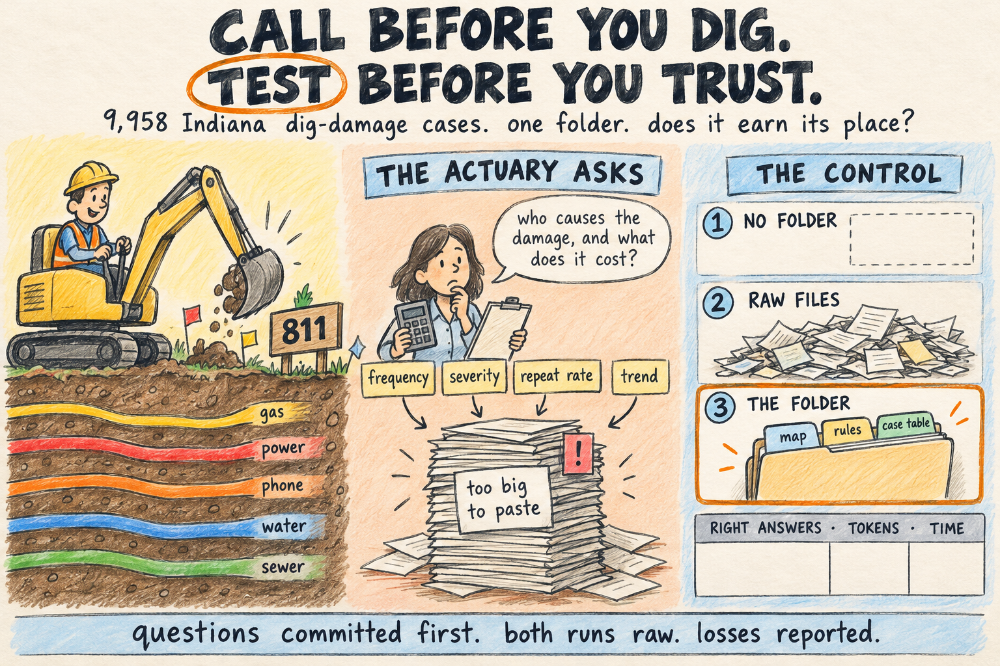

# Call before you dig. Test before you trust.

**The folder** (`folder/`) is an actuarial desk for Indiana's dig-damage enforcement record: 9,958 cases from
58 state orders (2021–2025), about 1.9M tokens, too big to paste into one prompt. It carries the cleaned case
table, its schema, a glossary, the 2025 law text, and a small tool that applies the question's definitions and
prints the numbers with case-number receipts.

**The test:** 10 actuarial questions plus 5 held-out questions by another author, all committed with a
script-computed answer key before any folder file or run. Three arms, same model (Claude Sonnet 5.5), three
runs each, sandboxed, graded blind.

**The result (Sonnet 5.5):** no folder, no files 0/60 · raw files, no folder 53/60 · the folder 60/60. On the held-out
questions the raw orders tied the folder, 30/30. **With Haiku 5.5** the raw orders scored 55/60 but used 4.7× the
tokens; Haiku with the folder scored 60/60 and 30/30 for $0.20 per 45 answers at list price, against $5.42 for
Sonnet on the raw orders. The folder's value was cost, and letting the cheap model match the expensive one.
Everything, losses and wrong predictions included, is in **[results.md](results.md)**.

## Order of events (check it in `git log`)

| Commit | What |
|---|---|
| ad04b56 … 45a8ccd | data: the 58 orders and the 2025 law, unchanged; text, parse, verify, one commit per step |
| 8f2d5c4, 91b9ea9 | data: schema; corrections ledger read from page images, with evidence |
| **134737f** | **questions, held-out questions, answer keys and independent cross-checks** |
| 24d70d6 | harness (sandboxed `run.py`, `audit.py`, `rerun.sh`) |
| 9ca642a | control run (no folder) |
| 0f574b1 | the folder, built by an agent that never saw the questions |
| b39ad40 | harness bug fix; the aborted first folder run kept in `aborted/` |
| d0ba5c2, ea75841 | treatment run (folder), raw-files run |
| 5a2c2de | blind grading |
| 5cec281 … 8f50ad0 | folder v2 (failed its prediction), fresh-clone re-run, their grading, v1 restored |
| a1c6ce6 … | the Haiku pair: predictions first, then runs (4eb5f43), then blind grading |

## Run it yourself

You need: Linux or WSL2 with `bubblewrap` and `socat` (`sudo apt install bubblewrap socat`), Python 3, `uv`
(only to rebuild the data), and the Claude Code CLI logged in. macOS should work (Claude Code's own sandbox)
but was not tested. Each run is sandboxed: it sees only its arm's files, no web; `rerun.sh` refuses to run if
the sandbox cannot start.

    python3 run.py --preflight                         # the sandbox starts, outside reads are denied
    ./rerun.sh control  --out rerun/control            # or: python3 run.py control --out rerun/control
    ./rerun.sh raw      --out rerun/raw
    ./rerun.sh folder   --out rerun/folder
    python3 audit_strict.py                            # 0 tool calls outside their own run
    ARMS="control=rerun/control/raw,raw=rerun/raw/raw,folder=rerun/folder/raw" OUT=grading-mine python3 grading/blind.py

Never run the arms from inside this repo with plain `claude`: Claude Code loads CLAUDE.md and AGENTS.md from
parent folders. `run.py` already works in a fresh temporary folder per answer. `--reps 1` runs each question once.

**In a Claude Project instead:** upload the folder's files (README, identity, rules, examples and everything in
`reference/`) and ask each question, preceded by the preamble in `questions.md`. Needs code execution for the tool.
We did not run this route; our numbers come from `run.py`.

## Files

| Path | What |
|---|---|
| `questions.md`, `heldout-questions.md` | the questions, the shared preamble with every definition, scoring rule, predictions, expected answers |
| `key/` | the answer-key scripts, their outputs, the independent cross-checks, `compare.py` |
| `folder/` | the folder under test (README, identity, rules, examples, reference/) |
| `control/`, `raw-files/`, `treatment/` | raw stream-json transcripts per answer, settings and exact command, `AUDIT.txt` |
| `treatment-v2/`, `rerun-fresh-clone/`, `haiku/` | the failed v2 change; the fresh-clone re-run; the Haiku pair |
| `grading-haiku/`, `predictions-haiku.md` | the Haiku pair's predictions and blind grades |
| `grading/`, `grading-2/` | blind packets, the hidden key, every grade with its reason, `scores.md` |
| `data/` | originals, every cleaning step, schema, corrections ledger with evidence. Start at `data/README.md` |
| `harness/`, `folder-build/`, `aborted/` | sandbox test report; how the folder was built; the aborted run |
| `results.md` | what changed, question by question, losses included |

Round 1, a pilot on the dig law itself (where the whole document fits in one prompt), is the separate repo
`indiana-dig-law-control`. Public record: the orders and the law come from in.gov. This is a test of a folder,
not legal or actuarial advice.
