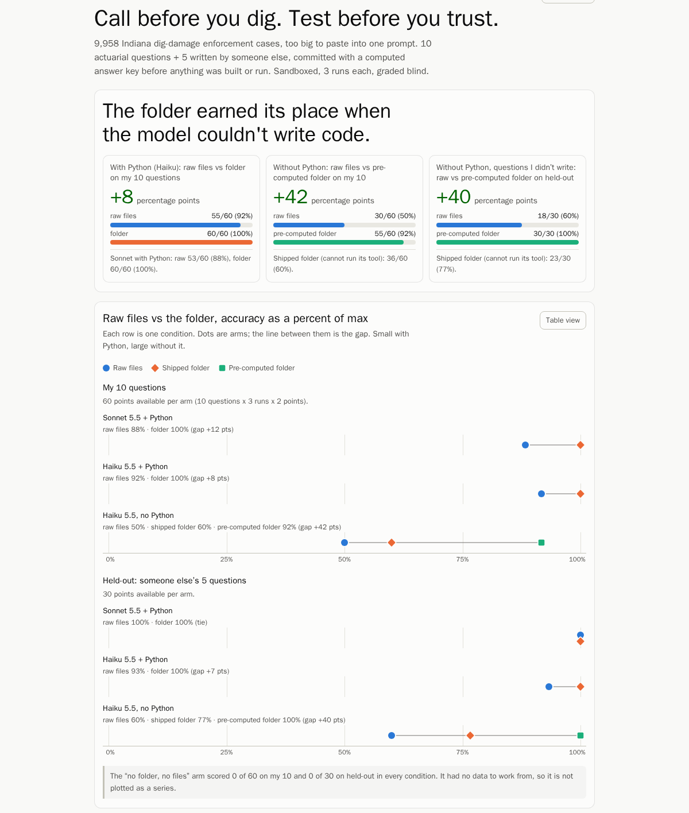

# Call before you dig. Test before you trust.

> **The entry is `control/` (no folder, no files) and `treatment/` (the folder), both Claude Sonnet 5.5 with
> Python, as the brief asks. `raw-files/` is the fair control (same data, no folder). Everything else is an
> extra experiment, labelled below.**

**Do not run `claude` inside this clone. `key/` holds the answer key, and reading it voids a run.** `run.py` works
in a fresh temporary folder outside the clone for every answer. (A root `.claude/settings.json` denies reads of
`key/` for a plain `claude` session, but treat that as a guard, not a seal.)

**The folder** (`folder/`) is an actuarial desk for Indiana's dig-damage enforcement record: 9,958 cases from
58 state orders (2021–2025), about 1.9M tokens, too big to paste into one prompt. It carries the cleaned case
table, its schema, a glossary, the 2025 law text, and a small tool that applies the question's definitions and
prints the numbers with case-number receipts. `folder/` is the only folder under test. `folder-nocode/` is the
folder for the no-Python experiment; `folder-build/` and `folder-nocode-build/` are the scripts that built them.

**The test:** 10 actuarial questions plus 5 held-out questions written by a model agent I directed (not a
stranger), all committed with a script-computed answer key before any folder file or run. Three arms, same model
(Claude Sonnet 5.5), three runs each, sandboxed, graded blind.

## The headline findings, by pair

| Pair | Result | Where it comes from |
|---|---|---|
| **The brief's pair: `control/` vs `treatment/`** (Sonnet 5.5, with Python) | no folder, no files **0/60**; the folder **60/60** | Not informative on its own: the no-files arm has nothing to compute from, so it scores 0 by construction. |
| **The fair control: `raw-files/` vs `treatment/`** (Sonnet 5.5, with Python) | raw files, no folder **53/60**; the folder 60/60. On the 5 held-out questions the raw orders **tied** the folder, 30/30. | The comparison that actually tests the folder. The folder's edge on Sonnet is cost (about 2.3× fewer tokens), not held-out correctness. |
| **Extra: Haiku 5.5** (`haiku/`) | raw orders 55/60 but 4.7× the tokens; Haiku with the folder 60/60 and 30/30 for $0.20 per 45 answers at list price, against $5.42 for Sonnet on the raw orders. | The folder's value was cost, and letting the cheap model match the expensive one. |
| **Extra: no Python at all** (`nocode/`, Haiku, read and search only) | raw files fell to 30/60 and 18/30; a folder of pre-computed tables scored 55/60 and 30/30, the cheapest and fastest of the no-Python arms ($0.26 for 45 answers). | Without code, the folder is what makes the answer. It is not the cheapest arm of the entry: Haiku with the shipped folder and Python was $0.20. |

Everything, losses and wrong predictions included, is in **[results.md](results.md)**.

The full results page, with every question, every arm, cost and the predictions I got wrong:
[assets/results.html](assets/results.html) (download and open; built from `assets/results-data.json`, which
`grading/summary.py` generates from the committed grades). Counts quoted in results.md that no other script
produces are recomputed from the transcripts by `python3 grading/claims.py`.

## Order of events (check it in `git log`)

| Commit | What |
|---|---|
| ad04b56 … 45a8ccd | data: the 58 orders and the 2025 law, unchanged; text, parse, verify, one commit per step |
| 8f2d5c4, 91b9ea9 | data: schema; corrections ledger read from page images, with evidence |
| **134737f** | **questions, held-out questions, answer keys and independent cross-checks** |
| 24d70d6 | harness (sandboxed `run.py`, `audit.py`, `rerun.sh`) |
| 9ca642a | control run (no folder) |
| 0f574b1 | the folder, built by an agent that never saw the questions |
| b39ad40 | harness bug fix; the aborted first folder run kept in `aborted/` |
| d0ba5c2, ea75841 | treatment run (folder), raw-files run |
| 5a2c2de | blind grading |
| 5cec281 … 8f50ad0 | folder v2 (failed its prediction), fresh-clone re-run, their grading, v1 restored |
| a1c6ce6 … | the Haiku pair: predictions first, then runs (4eb5f43), then blind grading |

## Run it yourself

**Check the answers.** The expected answers are the table in [questions.md](questions.md) (held-out ones in
`heldout-questions.md`). `python3 grading/blind.py` builds a blind grading packet (question, expected answer,
scoring rule, every arm's answer under a random label); set `ARMS` and `OUT` as below so it does not overwrite
`grading/`.

**Read the transcripts.** Each arm folder has a `TRANSCRIPT.md` next to `raw/` (for example
[control/TRANSCRIPT.md](control/TRANSCRIPT.md), [treatment/TRANSCRIPT.md](treatment/TRANSCRIPT.md)): per answer,
the exact prompt and system prompt, every tool call with a slice of its result, and the final answer verbatim.
It is generated by `render.py` from `raw/*.jsonl` and `raw/*.meta.json`; the evidence is those files, which were
never edited. The prompt is in the `.meta.json`, not the `.jsonl`. To regenerate:
`python3 render.py control treatment raw-files 'haiku/*' 'nocode/*' 'rerun-fresh-clone/*'`.

**Prerequisites:** Python 3 and the Claude Code CLI (2.1.296 was used), logged in (`claude auth login`) or with
`ANTHROPIC_API_KEY` set. Your account needs `claude-sonnet-5-5`. Each answer is one fresh `claude -p` session.

**Route 1, sandboxed (tested on Linux).** Needs Linux or WSL2 with `bubblewrap` and `socat`
(`sudo apt install bubblewrap socat`). Each run sees only its arm's files, no web; `rerun.sh` refuses to run if the
sandbox cannot start, then audits what it wrote.

    python3 run.py --preflight                         # the sandbox starts, outside reads are denied
    ./rerun.sh control  --out rerun/control            # or: python3 run.py control --out rerun/control
    ./rerun.sh raw      --out rerun/raw
    ./rerun.sh folder   --out rerun/folder
    python3 audit_strict.py rerun                      # 0 tool calls outside their own run
    ARMS="control=rerun/control/raw,raw=rerun/raw/raw,folder=rerun/folder/raw" OUT=grading-mine python3 grading/blind.py

`--reps 1` runs each question once; `--only Q1` runs one question. `--out` is never inside this repo's arm
inputs. macOS uses Claude Code's built-in sandbox and run.py no longer denies `/private/tmp` (which would have
blocked a run's own directory); **macOS has not been tested.**

**Route 2, UNSANDBOXED (for machines that cannot install bubblewrap and socat; labelled, weaker).**

    ./rerun.sh folder --no-sandbox --out /tmp/rerun/folder      # or: python3 run.py folder --no-sandbox --out DIR
    python3 audit_strict.py /tmp/rerun/folder

It runs the same command in the same fresh empty temp dir outside the clone, minus the sandbox settings, and
prints a loud warning: **nothing stops the model's shell from reading outside its folder**, including `key/` if
you point it there. Only Read/Grep/Glob are fenced, by permission rules. So `audit_strict.py` must be run
afterwards, and a run whose audit shows a call that SUCCEEDED outside its folder is void. This route was tested
once on Linux (see below); it has not been tested on macOS or Windows.

Never run the arms from inside this repo with plain `claude`: Claude Code loads CLAUDE.md and AGENTS.md from the
folder and its parents, and `key/` is in reach.

**In a Claude Project instead:** upload the folder's files (README, identity, rules, examples and everything in
`reference/`) and ask each question, preceded by the preamble in `questions.md`. Needs code execution for the tool.
We did not run this route; our numbers come from `run.py`.

## Re-run tested on 2026-10-11

From a fresh clone (`gh repo clone jdingus/dig-risk-control /tmp/judge-clone`, then `cd /tmp/judge-clone`, HEAD
4d2ef73), Linux, Claude Code 2.1.296, bubblewrap 0.8.0, logged-in CLI, Q1 only, one rep. This shows the commands
work from a clean checkout. It does not show that they work on another OS, and the clone used `gh` credentials
because the repo was private at the time.

| Command | Outcome |
|---|---|
| `./rerun.sh control --reps 1 --only Q1 --out /tmp/judge-out/control` | **Pass.** Preflight OK, `Q1-r1.jsonl ok 6.7s`. Answer: "I can't compute these percentages, because the working directory has no IURC order data", no estimate given. `audit.py`: 1 clean. `audit_strict.py`: 0 reached outside, 0 denied. |
| `./rerun.sh folder --reps 1 --only Q1 --out /tmp/judge-out/folder` | **Pass.** Preflight OK, `ok 8.4s`. Answer: 16(h) = 3,941 of 9,958 = **39.6%**, 20(a)(2) = 2,284 of 9,958 = **22.9%**, from `reference/tools/cases.py group --by base`; both match the expected answer. `audit_strict.py`: 0 reached outside. `audit.py` flagged the one transcript for a path in Claude Code's own saved-tool-output notice (`persisted-output` under the CLI's project folder); that is a tool result, not a tool call, and `rerun.sh` audited the `--out` directory it had just written. |
| `python3 run.py control --reps 1 --only Q1 --no-sandbox --out /tmp/judge-out/ns` | **Pass.** Warning printed, `ok 5.8s`, `meta.json` records `"sandboxed": false` and settings with the sandbox off. Same "no data" refusal. `audit_strict.py /tmp/judge-out/ns`: 0 reached outside. |
| `./rerun.sh folder --reps 1 --only Q1 --no-sandbox --out /tmp/judge-out/ns-folder` | **Pass.** Skips the self-test with a warning, `ok 11.3s`, 39.6% and 22.9%. `audit_strict.py`: 0 reached outside. |
| `PATH` without `bwrap`/`socat`: `./rerun.sh control --reps 1 --only Q1` | Refuses: "bubblewrap missing ... (or use the UNSANDBOXED route: add --no-sandbox --out DIR)". |
| `claude -p "Read key/README.md"` run inside the clone | Denied by `.claude/settings.json`. |

The Linux sandboxed settings JSON that `run.py` writes was compared before and after the macOS change and is
byte-identical. Not tested: macOS, Windows, WSL2, the `ANTHROPIC_API_KEY` login route, the full 45-answer arms from
this clone, and an anonymous (logged-out) clone.

## Files

| Path | What | In the entry? |
|---|---|---|
| `control/` | raw stream-json transcripts of the no-folder, no-files run, settings and exact command, `AUDIT.txt`, `TRANSCRIPT.md` | **Yes** (the brief's control) |
| `treatment/` | the same for the folder run | **Yes** (the brief's treatment) |
| `folder/` | the folder under test (README, identity, rules, examples, reference/). `examples.md` is longer than `rules.md` because it holds three worked examples with pasted tool output | **Yes**, the only folder under test |
| `questions.md` | the questions, the shared preamble with every definition, scoring rule, predictions, expected answers | **Yes** |
| `key/` | the answer-key scripts, their outputs, the independent cross-checks, `compare.py`. Do not read before running | **Yes** |
| `results.md` | what changed, question by question, losses included | **Yes** |
| `raw-files/` | transcripts of the fair control: the 58 orders and their text, no folder | Fair control (not named in the brief) |
| `grading/` | blind packets, the hidden key, every grade with its reason, `scores.md`, `claims.py` | Yes (grades for the three arms above) |
| `heldout-questions.md` | 5 held-out questions by a model agent I directed | Extra |
| `treatment-v2/`, `grading-2/`, `rerun-fresh-clone/` | the failed v2 change; the fresh-clone re-run and their grades | Extra |
| `haiku/`, `grading-haiku/`, `predictions-haiku.md` | the Haiku pair, its predictions and blind grades | Extra |
| `nocode/`, `folder-nocode/`, `grading-nocode/`, `predictions-nocode.md` | the no-Python experiment: runs, the pre-computed folder, grades, predictions | Extra |
| `folder-build/`, `folder-nocode-build/` | how the two folders were built (build material, not folders under test) | Extra |
| `aborted/` | the aborted first folder run, kept with its explanation | Extra |
| `run.py`, `rerun.sh`, `audit.py`, `audit_strict.py`, `render.py` | the harness, re-run script, audits, transcript renderer | Tools |
| `data/` | originals, every cleaning step, schema, corrections ledger with evidence. Start at `data/README.md` | Support |
| `harness/`, `assets/`, `.claude/settings.json` | sandbox test report; images and results page; denies reading `key/` for plain `claude` | Support |

Round 1, a pilot on the dig law itself (where the whole document fits in one prompt), is the separate repo
`indiana-dig-law-control`. Public record: the orders and the law come from in.gov. This is a test of a folder,
not legal or actuarial advice.
